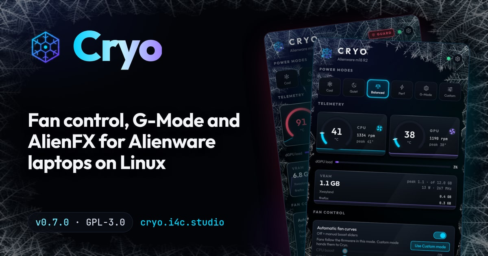
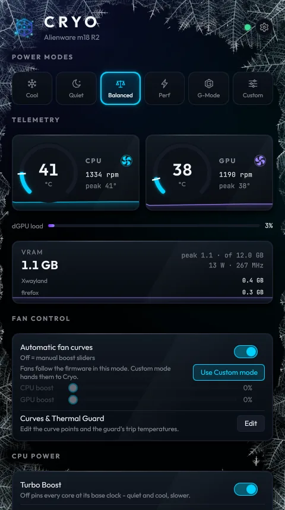
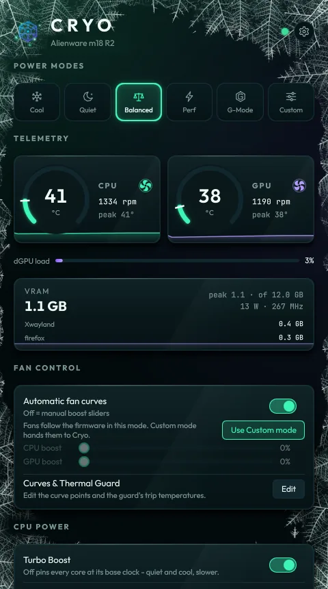
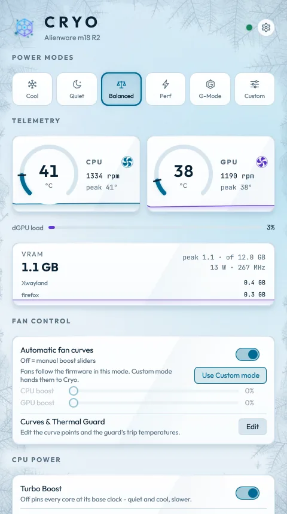
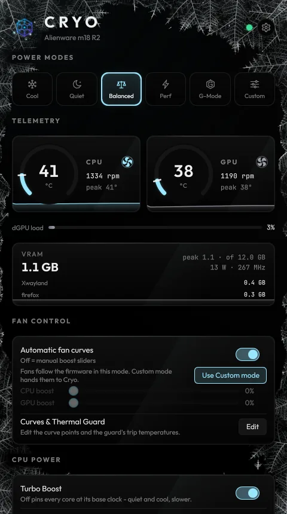

<div align="center">
  
</div>

# Cryo

Website: [cryo.i4c.studio](https://cryo.i4c.studio)

[](https://github.com/I4cTime/cryo/actions/workflows/ci.yml)
[](https://github.com/I4cTime/cryo/releases)
[](https://cryo.i4c.studio/download/linux-x86_64)
[](https://cryo.i4c.studio)
[](https://cryo.i4c.studio/docs)
[](https://cryo.i4c.studio)
[](https://www.python.org/)
[](https://github.com/I4cTime/cryo/blob/main/LICENSE)
[](https://discord.gg/5uEApw5uEz)
[](https://x.com/i4c_studio)
[](https://ko-fi.com/i4ctime)

The Alienware command center Dell never shipped for Linux, for Alienware
and Dell G-Series machines on the mainline **alienware-wmi** kernel
driver. A root daemon + QML GUI + CLI - no `acpi_call`, no out-of-tree
modules - that does things stock AWCC (and the Windows original) don't:

- **Custom fan curves** - temp→boost curves per fan group with hysteresis,
  driven through the kernel's `custom` platform profile, editable in the
  GUI or with `cryoctl curve`.
- **Thermal Guard** - an emergency failsafe in *any* profile: trip
  temperatures force 100% fans, hold, then restore your previous state.
  Thresholds are editable in the GUI or with `cryoctl guard`.
- **CPU power cap** - a per-power-mode ceiling on the CPU's performance
  state (`intel_pstate max_perf_pct`), re-applied on every mode switch and
  after resume. On the m18 R2, 90% ≈ 5.2 GHz single-core: about 12 W and
  9 °C off the in-game CPU peak while the GPU gets more headroom.
- **Game detection** - sustained dGPU load (NVML) flips the machine into
  G-Mode automatically, and restores your previous profile when you quit.
- **Auto profiles** - battery → quiet, AC → balanced, all configurable,
  fired on transitions only so manual picks stick.
- **Live telemetry** - CPU/GPU temps, fan RPM, dGPU load, power draw and
  clocks, VRAM usage with session peak and a per-process breakdown,
  sparkline history - in-window, in the tray tooltip, and streamable to
  CSV with `cryoctl watch --log` for long debugging sessions.
- **AlienFX lighting** - chassis effects on the rear rings, lid logo and
  power button (AW-ELC protocol ported from AWCC), including a `quantum`
  cyan↔violet preset, plus the per-key keyboard backlight (a separate
  Darfon USB device on the m16/m18: colour, brightness and its firmware
  breathe / wave / pulse / night-rider effects), all restored on boot.
- **A window with a temperature** - frost frames the GUI while the machine
  is cool and recedes as it heats, the background shifts from cold to hot
  colours, and a Thermal Guard trip sweeps frost across the window until
  it releases. Temperatures and fan speeds roll digit by digit, and the
  header mark's orbit follows the fans. Settings (the gear) offers four
  styles (Cryo, Aurora, Glacier light, Blackout), an accent override,
  reduce motion, optional synthesized interface sounds (off by default)
  and a one-line status from Frost in the footer, worked out locally with
  no network. Animation pauses while the window is hidden, minimized or
  unfocused, so the GUI doesn't warm the machine it is watching.

<p align="center">
  
  
  
  
</p>
<p align="center"><sub>The four styles: Cryo, Aurora, Glacier and Blackout. Try them without an Alienware with <code>cryo-gui --demo</code>, or in the simulation on <a href="https://cryo.i4c.studio">cryo.i4c.studio</a>.</sub></p>

## Will it work on my machine?

Developed on an **Alienware m18 R2** (Arch Linux); designed for the wider
alienware-wmi ecosystem - the daemon probes what your machine supports at
startup (profiles, G-Mode, fan boost, lighting, turbo control, NVML) and
every client renders only what exists. Reported so far:

| Model | Verdict |
| ----- | ------- |
| Alienware m18 R2 (Intel + RTX 4080) | SUPPORTED - everything works (maintainer) |
| Alienware 16X Aurora AC16251 (Core Ultra 9 275HX + RTX 5060) | SUPPORTED - everything works ([#21](https://github.com/I4cTime/cryo/issues/21)) |
| Alienware Aurora R4 (2011 desktop) | LIMITED - GPU telemetry, game detection, turbo and CPU cap only ([#9](https://github.com/I4cTime/cryo/issues/9)) |

No Dell G-Series report yet. See
[docs/COMPATIBILITY.md](docs/COMPATIBILITY.md) for the feature matrix.
`cryoctl doctor` works before you trust Cryo with your fans; a model
report is the most useful thing you can send, working or not:

```sh
cryoctl doctor   # hardware/driver report with a supported / partial /
                 # unsupported verdict, made for pasting into an issue
```

## Architecture

```
┌──────────────┐   unix socket (JSON lines)   ┌─────────────────────┐
│ cryo-gui     │◄────────────────────────────►│ cryod (root,        │
│ (QML + tray) │      /run/cryo.sock          │  systemd service)   │
└──────────────┘                              │  · platform profile │
┌──────────────┐                              │  · hwmon fan boost  │
│ cryoctl (CLI)│◄────────────────────────────►│  · NVML game sense  │
└──────────────┘                              │  · AlienFX ELC USB  │
                                              └─────────────────────┘
```

Everything thermal goes through sysfs (`alienware-wmi` kernel driver):
the per-handler node under `/sys/class/platform-profile/` and the
`alienware_wmi` hwmon (`fan*_boost`, `fan*_input`, `temp*_input`).
Lighting talks to the AW-ELC USB controller (`187c:0550/0551`) for the
chassis lights and, where present, to the Darfon per-key keyboard
(`0d62:aab1`/`bab1`) over hidraw for the backlight.

Profile names are translated per machine from what the kernel advertises.
On G-Mode-capable models:

| Cryo/AWCC name | kernel platform_profile |
| -------------- | ----------------------- |
| performance    | balanced-performance    |
| gmode          | performance             |
| custom         | custom (manual fans)    |

On models without G-Mode, kernel `performance` *is* AWCC Performance and
Cryo labels it accordingly.

## Install

Download `cryo-<version>-linux-x86_64.tar.gz` from
[cryo.i4c.studio/download/linux-x86_64](https://cryo.i4c.studio/download/linux-x86_64)
or the [latest release](https://github.com/I4cTime/cryo/releases/latest),
then:

```sh
tar xf cryo-*-linux-x86_64.tar.gz && cd cryo-*/
sudo ./install.sh   # /opt/cryo + cryoctl/cryo-gui in /usr/local/bin + systemd units + icons + .desktop
```

Requires: an x86_64 glibc distro with systemd, the `alienware-wmi` kernel
driver (mainline; fan control needs its hwmon, which landed in Linux
6.16), network access during the install (it downloads about 300 MB: its
own Python 3.13 and the hash-checked Qt dependencies), and - for game
detection - the NVIDIA proprietary driver. No git or uv needed.
[docs/INSTALL.md](docs/INSTALL.md) covers verifying the download
(`SHA256SUMS`, `gh attestation verify`), what goes where, and replacing a
from-source install. The release tarball is the only package; there is no
distro package, Flatpak or PyPI release.

To update, run `install.sh` from the newer bundle the same way; it builds
the new environment beside the old one, swaps it in and restarts `cryod`,
keeping `/etc/cryo` and `/var/lib/cryo`.

From source (for working on Cryo; needs Python 3.12+ and
[`uv`](https://docs.astral.sh/uv/getting-started/installation/) on your
user's PATH, and the checkout must stay where it is):

```sh
git clone https://github.com/I4cTime/cryo.git && cd cryo
sudo packaging/install.sh   # venv sync + /etc/cryo + systemd unit + icons + .desktop
```

Update a from-source install by pulling and re-running the installer:

```sh
cd cryo && git pull && sudo packaging/install.sh
```

## Use

```sh
cryoctl status | watch
cryoctl profile gmode / cryoctl gmode
cryoctl boost cpu 60
cryoctl cap 90                       # CPU cap for the current mode (cap gmode 95 for another)
cryoctl curve cpu 45:0 60:15 70:35 80:60 95:100
cryoctl guard cpu 90 / cryoctl guard show
cryoctl light quantum / cryoctl light static 00D1FF
cryoctl doctor
cryo-gui
```

To try the GUI without an Alienware machine, run it in demo mode from a
clone - no install, no root, no daemon:

```sh
uv run cryo-gui --demo   # --scenario idle | load | guard | gaming | cycle (default)
```

Demo mode drives the real interface from a scripted stand-in for `cryod`:
simulated temperatures, fans, a game session and a Thermal Guard trip,
with every control responding. Nothing in it touches hardware, and its
settings are stored apart from the real app's.

Config lives at `/etc/cryo/config.json` (deep-merged over defaults in
`cryo/daemon/config.py`) - fan curve points, guard thresholds, CPU caps per
mode, auto-rule targets, game detection thresholds, socket group. The file
holds only your overrides. The daemon rewrites it only when you change a
setting from the GUI or `cryoctl curve/guard/cap` (every patch is
validated first, and keys you never touched keep tracking new defaults);
what the daemon changes on its own (last lighting, the curves-off latch a
manual boost sets) lives in `/var/lib/cryo/state.json`.

After suspend, `cryod-resume.service` runs `cryoctl reapply`, which reopens
the lighting controller, re-asserts the platform profile and re-initializes
NVML. The daemon also retries NVML on its own every 30 s while the NVIDIA
driver is missing, so starting before the driver loads is fine.

## Notes

- Lighting protocol ported from tr1xem/AWCC (GPL-3.0); the keyboard
  protocol follows T-Troll/alienfx-tools and tr1xem/alienfx-linux. This
  repo is GPL-3.0-or-later accordingly.
- On the m18 R2 the power button follows the effect, which replaces the
  controller's stock "blue on AC" power-state colour. That setting lives
  in the controller; AWCC on Windows reprograms it if you dual-boot.
- Game detection needs the NVIDIA driver's NVML (present with the
  proprietary driver). Without it, Cryo degrades to manual + AC/battery
  rules only.
- Fan boost is not implemented by every model's firmware; when the
  startup probe finds it missing, curves and the Thermal Guard disable
  themselves visibly rather than failing silently.
- On a machine the alienware-wmi driver only partly covers (no hwmon
  and/or no platform profiles - typically pre-2012 desktops), `cryod`
  runs in **limited mode**: fans, curves, the guard and power modes are
  out, but GPU telemetry, game detection, the turbo toggle, the CPU cap
  and lighting still work where present, and every client hides the
  rest. Only a machine with nothing at all to drive makes `cryod` log one
  plain-language reason and exit 78 without restarting. `cryoctl doctor`
  gives the same SUPPORTED / PARTIAL / LIMITED / UNSUPPORTED verdict
  without the daemon.

## Uninstall

Installed from the release bundle:

```sh
sudo /opt/cryo/uninstall.sh   # add --purge to also remove /etc/cryo and /var/lib/cryo
```

`cryod` leaves the firmware where it last put it, so the uninstaller first
hands the machine back to stock (the `cryoctl` commands below) when the
daemon is running, then removes everything the installer added.

Installed from source, hand the machine back to stock first, then remove
what `packaging/install.sh` added:

```sh
cryoctl profile balanced && cryoctl boost cpu 0 && cryoctl boost gpu 0 && cryoctl cap 100
sudo systemctl disable --now cryod.service cryod-resume.service
sudo rm /etc/systemd/system/cryod.service /etc/systemd/system/cryod-resume.service
sudo systemctl daemon-reload
sudo rm -r /etc/cryo /var/lib/cryo
rm ~/.local/bin/cryoctl ~/.local/bin/cryo-gui ~/.local/share/applications/cryo.desktop
rm ~/.local/share/icons/hicolor/*/apps/cryo.png ~/.local/share/icons/hicolor/scalable/apps/cryo.svg
```

Then delete the cloned `cryo` directory. Skip the `boost` or `cap`
commands your machine doesn't support (`cryoctl doctor` lists them).
